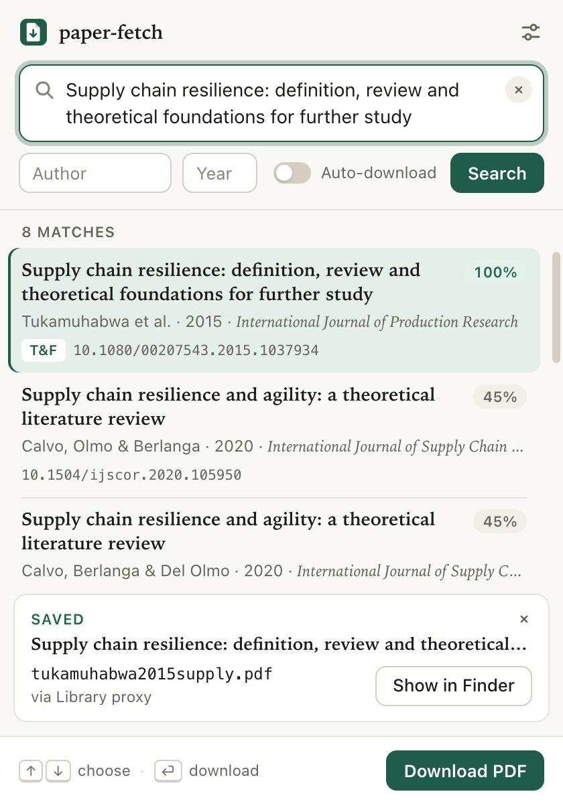

# paper-fetch

[中文说明](README.zh-CN.md)

A Chrome extension that finds a paper by title or DOI and saves the PDF, using the access you already have: your campus network, your library's proxy, EBSCO, or an open-access copy.

<p>
  
  
  
</p>

## What it does

1. Paste a title or a DOI and press <kbd>Enter</kbd>. The paper is looked up on [Crossref](https://www.crossref.org/) and the matches are listed, best first.
2. Press <kbd>Enter</kbd> again (or pick another match with <kbd>↑</kbd> <kbd>↓</kbd>). paper-fetch tries these routes in order and stops at the first that returns a PDF:

   | Route | Works when |
   | --- | --- |
   | Publisher | you are on campus or on the university VPN, or the article is free at the publisher |
   | Library proxy | you are signed in to your library's EZproxy |
   | EBSCO | your library subscribes to EBSCO and you are signed in |
   | Open access | [OpenAlex](https://openalex.org/) knows a free copy |

3. The PDF lands in Downloads as `<first author><year><first title word>.pdf`, for example `tukamuhabwa2015supply.pdf`.

If every route fails, the popup says what each one ran into (sign-in needed, no access, not in EBSCO) and offers one click to open the article through your library so you can fetch it by hand. The download keeps going if you close the popup.

## Install

It is not on the Chrome Web Store yet. To load it from source:

1. Download this repository (Code → Download ZIP, then unzip) or `git clone` it.
2. Open `chrome://extensions`, turn on **Developer mode**, click **Load unpacked** and choose the `extension` folder.

The settings page opens on first install.

## Set up for your library

| Your situation | What to do |
| --- | --- |
| On campus, or on the university VPN | Nothing. |
| Off campus, and your library has EZproxy | Paste your library's proxy link into settings (below). |
| Your library has EBSCO | Sign in to EBSCO once in this browser. The rest is found automatically. |
| None of these | Open-access copies still download; for the rest you get a link to the article page. |

**Finding your proxy link.** It is the address your library puts in front of database links, and usually looks like one of these:

```
https://login.ezproxy.youruni.edu/login?url=
https://youruni.idm.oclc.org/login?url=
```

Search for "*your university* EZproxy prefix", or open any database from your library's website while off campus and copy the address of the sign-in page. You can paste the whole address into settings; everything after `url=` is trimmed off.

## What is and isn't covered

**Direct publisher downloads** exist for publishers whose PDF address follows from the DOI: Wiley, Springer (incl. Palgrave), Taylor & Francis, Sage, INFORMS, Nature, Science, PNAS, ACS, ACM, SIAM, Academy of Management, University of Chicago Press, Royal Society, ASCE and IOP. For everything else (Elsevier, IEEE, Oxford, Cambridge, JSTOR, …) paper-fetch relies on EBSCO and open access, and otherwise hands you the article page.

**How far it has been tested.** The automated tests run every route against stand-in servers, plus live lookups on Crossref and OpenAlex and live downloads of two open-access articles. In real use it has run against one university's library. Other libraries should work if they use EZproxy or EBSCO, but that is expected, not confirmed. Reports either way are welcome.

**Known limits**

- EBSCO is driven through its web page, so the EBSCO interface has to be in English, and a redesign on their side can break this route.
- Web-VPN portals that rewrite addresses (common at universities in mainland China) cannot be used as the proxy link. On campus or on a full VPN the publisher route works without it.
- OpenAthens redirector links are accepted in settings but have not been tested.
- The added publisher addresses follow each platform's standard pattern; only Nature and IOP were confirmed against the live sites.

## Privacy

paper-fetch has no server and no analytics. The title or DOI you search goes to Crossref; the DOI of the paper you download goes to OpenAlex; the download itself goes to the publisher, your library proxy or EBSCO, as it would if you clicked the link yourself. Settings stay in the browser. It uses the sessions you are already signed in to and never sees a password. Details: [PRIVACY.md](PRIVACY.md).

Permissions it asks for: **downloads** (save the PDF), **storage** (settings), and **scripting on ebsco.com** (to run the search on the EBSCO page).

## Use it within your library's terms

paper-fetch does not get around paywalls. It only reaches what your own subscriptions or open access already give you. Publisher licences forbid systematic bulk downloading, and libraries can lose access over it, so this downloads one paper at a time, on your request.

## Development

```
node tests/unit.mjs extension      # matching, naming, proxy-link handling
node tests/e2e.mjs                 # drives the real extension in headless Chrome
node tests/e2e.mjs --shots docs/screenshots
scripts/package.sh                 # dist/paper-fetch-<version>.zip
```

The end-to-end test needs Chrome, `openssl` and a network connection. It uses its own throwaway browser profile.

```
extension/
  background.js   search, the four download routes, download progress
  lib.js          Crossref/OpenAlex lookups, title matching, publisher table, file names
  popup.*         the popup
  options.*       the settings page
  theme.css       colours and shared controls (light and dark)
tests/            unit and end-to-end tests, stand-in library sites
```

No build step, no dependencies.

## License

[MIT](LICENSE)
