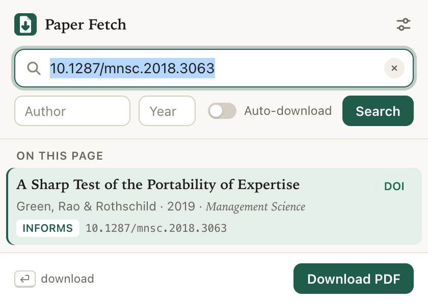
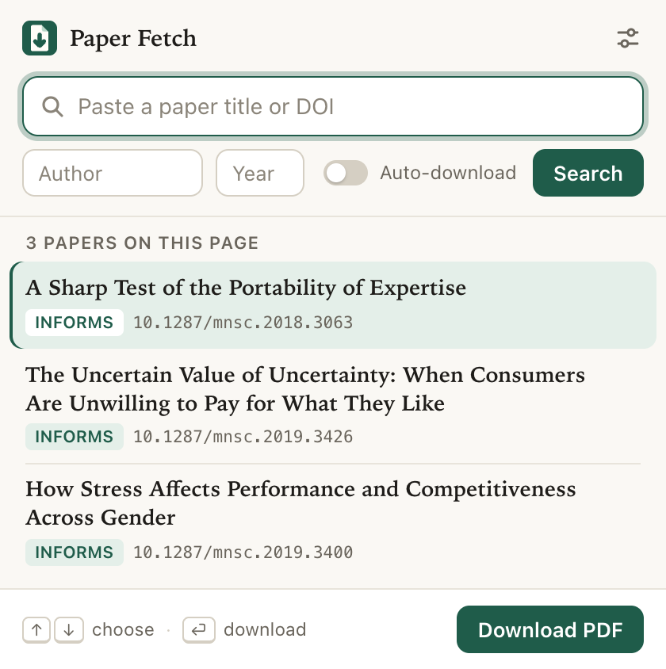
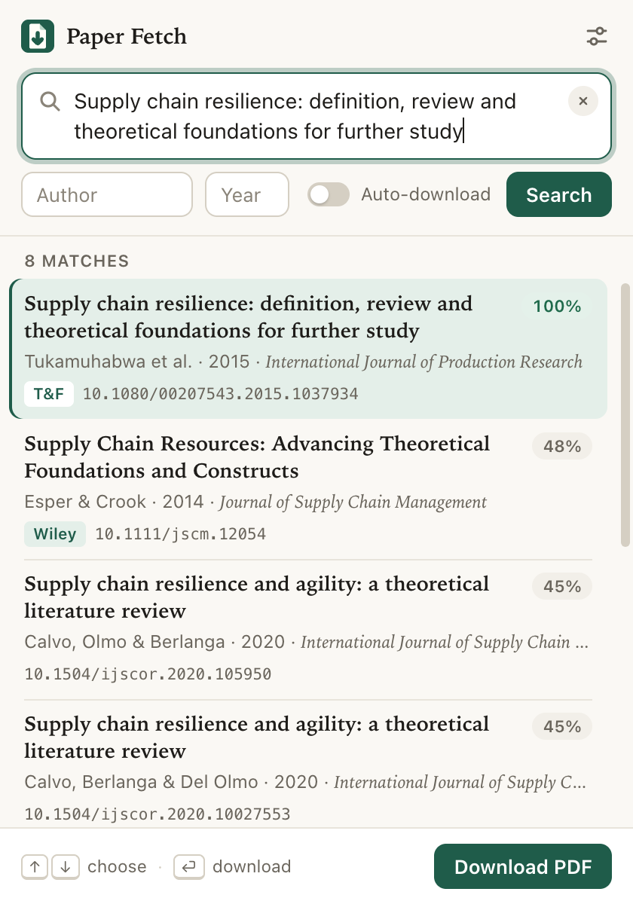

# Paper Fetch

[中文说明](README.zh-CN.md)

A Chrome extension that saves a paper as a properly named PDF in one click, through your own university library. It was built for INFORMS journals (*Management Science*, *Operations Research*, *M&SOM* and the rest) and works for other papers too.

<p>
  
  
  
</p>

## Why this exists

On the INFORMS site, signing in through my university no longer leads to a download. To get a paper I had to leave the article, go to the library's databases, search for the same paper again, and download it there. Paper Fetch makes that trip for you:

- **One click from the article.** Open it on an INFORMS article or issue page and the paper is recognised from the page.
- **It finds your library's proxy.** Type your university's name once and its proxy link is filled in.
- **It downloads from EBSCO directly.** Once you are signed in to your library's EBSCO, the paper is searched for and downloaded there, in the background.
- **A title is enough.** When a title is all you have, it is looked up on Crossref and you pick the match.

It only ever uses your own university sign-in. See the [disclaimer](#disclaimer).

## What it does

**On an INFORMS page**

- On an article, click the Paper Fetch button. The paper is recognised from the page; press <kbd>Enter</kbd> and it is saved.
- On an issue, an Articles in Advance list or search results, the papers on the page are listed. Pick one with <kbd>↑</kbd> <kbd>↓</kbd> and press <kbd>Enter</kbd>.
- It works the same when you are reading INFORMS through your library's proxy.

**Anywhere else**

- Article pages of other publishers are recognised the same way, as long as the page names its DOI.
- Or paste any title or DOI. The paper is looked up on [Crossref](https://www.crossref.org/) and the matches are listed, best first.

**Getting the PDF.** Paper Fetch tries these routes in order and stops at the first that returns a PDF:

| Route | Works when |
| --- | --- |
| This page | the page you are on links to its PDF and you have access there |
| Publisher | you are on campus or on the university VPN, or the article is free |
| Library proxy | you are signed in to your library's EZproxy |
| EBSCO | your library subscribes to EBSCO and you are signed in |
| Open access | [OpenAlex](https://openalex.org/) knows a free copy |

The file lands in Downloads as `<first author><year><first title word>.pdf`, for example `green2019sharp.pdf`. If every route fails, the popup says what each one ran into and offers one click to open the article through your library. The download keeps going if you close the popup.

## Install

It is not on the Chrome Web Store yet. To load it from source:

1. Download this repository (Code → Download ZIP, then unzip) or `git clone` it.
2. Open `chrome://extensions`, turn on **Developer mode**, click **Load unpacked** and choose the `extension` folder.

The settings page opens on first install.

## Set up for your library

| Your situation | What to do |
| --- | --- |
| On campus, or on the university VPN | Nothing. |
| Off campus | In settings, type your university's name, pick it, and press **Sign in**. |
| Your library has EBSCO | Sign in to EBSCO once in this browser. The rest is found automatically. |

Once you have signed in, the **Sign in** button in settings turns into a red **Sign out**, so you can see whether your library session is live and end it when you are done. The first time you press Sign in, Chrome asks whether Paper Fetch may read your library proxy's pages; that is only used for this check, and declining leaves everything else working.

The university search covers about 1,500 libraries that use EZproxy, from the public list at [libproxy-db.org](https://libproxy-db.org/). If yours is not there, either paste any link from your library's website that goes through its proxy (it is trimmed to the part that matters), or open the popup while you are on your library's sign-in page and choose **Use it for downloads**.

## About EBSCO

EBSCO is not a subject database. It hosts many databases that libraries subscribe to, each with its own field: Business Source for business and management, Academic Search for general scholarship, and others for psychology, education, nursing and so on. For a business school the first is the one that matters, since it carries the full text of a great many management journals. Which databases and years you get depends on your library's subscription. Paper Fetch uses EBSCO as one more way to reach a PDF when the publisher's site does not give it to you.

## What is and isn't covered

**INFORMS journals** all share one site and one address pattern, so all of them work: *Management Science*, *Operations Research*, *Manufacturing & Service Operations Management*, *Marketing Science*, *Information Systems Research*, *Organization Science*, *Mathematics of Operations Research*, *Transportation Science*, *INFORMS Journal on Computing*, *Decision Analysis*, *Strategy Science* and the others at pubsonline.informs.org.

**Other publishers with a direct PDF address:** Wiley, Springer (incl. Palgrave), Taylor & Francis, Sage, Nature, Science, PNAS, ACS, ACM, SIAM, Academy of Management, University of Chicago Press, Royal Society, ASCE and IOP. For the rest (Elsevier, IEEE, Oxford, Cambridge, JSTOR, …) Paper Fetch uses the PDF link on the article page when you open it there, then EBSCO and open access, and otherwise hands you the article page.

**How far it has been tested.** The automated tests run every route against stand-in servers built to look like the real sites, plus live lookups on Crossref and OpenAlex and live downloads of two open-access articles. The INFORMS site blocks automated browsers, so recognition there was tested on a stand-in with the same addresses and tags, not on the live site. In real use it has run against one university's library. Reports from other libraries are welcome, whether it worked or not.

**Known limits**

- EBSCO is driven through its web page, so the EBSCO interface has to be in English, and a redesign on their side can break this route.
- Web-VPN portals that rewrite addresses (common at universities in mainland China) cannot be used as the proxy link. On campus or on a full VPN the publisher route works without it.
- Proxy links from the university list are used as listed there; some may be out of date. **Sign in** in settings shows at once whether yours works.
- The direct addresses for publishers other than INFORMS follow each platform's standard pattern; only Nature and IOP were confirmed against the live sites.

## Privacy

Paper Fetch has no server and no analytics. The title or DOI you search goes to Crossref; the DOI of the paper you download goes to OpenAlex; the download itself goes to the publisher, your library proxy or EBSCO, as it would if you clicked the link yourself. When you click its button, it reads the address and article tags of the page you are on, and that stays in your browser. Settings stay in the browser. It uses the sessions you are already signed in to and never sees a password. Details: [PRIVACY.md](PRIVACY.md).

Permissions it asks for: **activeTab** (read the page you click the button on), **downloads** (save the PDF), **storage** (settings), and **scripting on ebsco.com** (run the search on the EBSCO page). Optionally, and only if you allow it when asked: **your library proxy's site**, to show whether you are signed in.

## Disclaimer

- **Your own access only.** Paper Fetch downloads through the university sign-in you complete yourself, in your own browser. It has no account or access of its own and never sees your password.
- **Not a download service.** It does not supply papers, share anyone's access, or download on anyone's behalf. What your library does not give you, Paper Fetch cannot get, apart from a legally open-access copy.
- **Do not bulk download.** Publisher licences forbid systematic downloading, and a library can have its access suspended over it. Paper Fetch saves one paper at a time, when you ask. Do not script it or use it to harvest issues or journals.
- You are responsible for following your library's and the publishers' terms of use. Paper Fetch is an independent project, not affiliated with INFORMS, EBSCO, Crossref, OpenAlex, or any publisher or library.

## Development

```
node tests/unit.mjs extension      # matching, naming, page and proxy-link handling
node tests/e2e.mjs                 # drives the real extension in headless Chrome
node tests/e2e.mjs --shots docs/screenshots
scripts/package.sh                 # dist/paper-fetch-<version>.zip
node scripts/icons.mjs              # re-render the PNG icons from icons/icon.svg
```

The end-to-end test needs Chrome, `openssl` and a network connection. It uses its own throwaway browser profile.

```
extension/
  background.js   search, the download routes, download progress
  lib.js          Crossref/OpenAlex lookups, title matching, publisher table, file names
  popup.*         the popup, including reading the page it is opened on
  options.*       the settings page
  theme.css       colours and shared controls (light and dark)
tests/            unit and end-to-end tests, stand-in publisher and library sites
```

No build step, no dependencies.

## License

[MIT](LICENSE)
