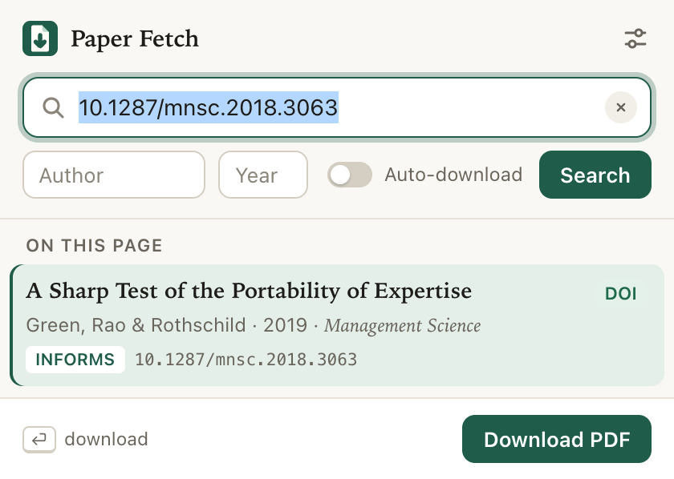
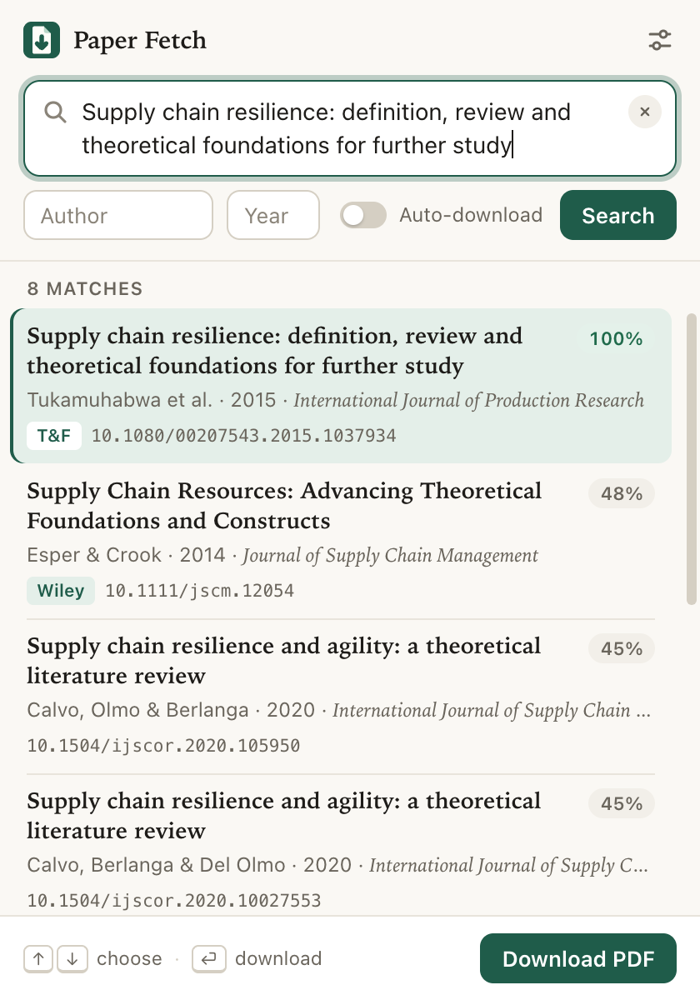

# Paper Fetch

[English](README.md)

在 INFORMS 期刊（*Management Science*、*Operations Research*、*M&SOM* 等）的页面上点一下，就把论文存成命名规范的 PDF。其他来源的论文，则通过你本来就有的访问权限获取：出版社网站、学校图书馆代理、EBSCO，或开放获取版本。

<p>
  
  
  
</p>

## 它做什么

**在 INFORMS 页面上**

- 在文章页点 Paper Fetch 按钮，论文会从页面上直接识别出来；按 <kbd>Enter</kbd> 就保存。
- 在某一期的目录页、Articles in Advance 列表或搜索结果页，会列出页面上的全部论文；用 <kbd>↑</kbd> <kbd>↓</kbd> 选一篇，按 <kbd>Enter</kbd>。
- 通过学校图书馆代理访问 INFORMS 时也一样可用。

**在其他地方**

- 其他出版社的文章页同样能识别，只要页面里标明了 DOI。
- 或者粘贴任意标题或 DOI。扩展会到 [Crossref](https://www.crossref.org/) 查询，按匹配度列出结果。

**怎么拿到 PDF。** 按下面的顺序尝试，拿到 PDF 就停：

| 途径 | 什么时候能用 |
| --- | --- |
| 当前页面 | 你所在的页面带有 PDF 链接，而且你在这个页面上有访问权限 |
| 出版社 | 你在校园网或学校 VPN 里，或者这篇文章免费 |
| 图书馆代理 | 你已登录学校图书馆的 EZproxy |
| EBSCO | 学校订了 EBSCO，并且你已登录 |
| 开放获取 | [OpenAlex](https://openalex.org/) 收录了免费版本 |

文件存到"下载"文件夹，命名为 `<第一作者姓><年份><标题首词>.pdf`，例如 `green2019sharp.pdf`。如果所有途径都失败，弹窗会说明每一条卡在哪，并给一个按钮通过图书馆打开文章页面。下载过程中关掉弹窗不影响下载。

## 安装

目前还没上架 Chrome 应用商店，需要从源码加载：

1. 下载本仓库（Code → Download ZIP 后解压），或者 `git clone`。
2. 打开 `chrome://extensions`，打开右上角的**开发者模式**，点**加载已解压的扩展程序**，选择 `extension` 文件夹。

第一次安装会自动打开设置页。

## 按你学校的情况设置

| 你的情况 | 怎么做 |
| --- | --- |
| 在校园网，或连着学校 VPN | 什么都不用设。 |
| 在校外 | 在设置里输入学校名称，选中它，然后点 **Sign in**。 |
| 学校订了 EBSCO | 在这个浏览器里登录一次 EBSCO，其余自动识别。 |

学校搜索覆盖约 1500 所使用 EZproxy 的图书馆，数据来自公开目录 [libproxy-db.org](https://libproxy-db.org/)（学校名称为英文）。如果没有你的学校，有两个办法：把图书馆网站上任意一个经过代理的链接粘贴进去（会自动截取有用的部分）；或者在图书馆登录页上打开弹窗，点 **Use it for downloads**。

## 关于 EBSCO

EBSCO 不是某个学科的数据库，而是一个平台，上面有图书馆订购的许多数据库，各有侧重：Business Source 面向商科与管理，Academic Search 面向综合学术，另外还有心理学、教育、护理等方向。对商学院来说最重要的是第一个，它收录了大量管理类期刊的全文。具体能看到哪些库、哪些年份，取决于学校的订购。当出版社网站拿不到 PDF 时，Paper Fetch 把 EBSCO 当作另一条获取途径。

## 支持范围

**INFORMS 期刊**都在同一个网站上，地址规则统一，所以全部支持：*Management Science*、*Operations Research*、*Manufacturing & Service Operations Management*、*Marketing Science*、*Information Systems Research*、*Organization Science*、*Mathematics of Operations Research*、*Transportation Science*、*INFORMS Journal on Computing*、*Decision Analysis*、*Strategy Science*，以及 pubsonline.informs.org 上的其他期刊。

**其他可以直连 PDF 的出版社：** Wiley、Springer（含 Palgrave）、Taylor & Francis、Sage、Nature、Science、PNAS、ACS、ACM、SIAM、Academy of Management、芝加哥大学出版社、Royal Society、ASCE、IOP。其余出版社（Elsevier、IEEE、牛津、剑桥、JSTOR 等）在文章页上打开时会用页面自带的 PDF 链接，其次是 EBSCO 和开放获取；再不行就给你文章页面。

**测试到什么程度。** 自动化测试用仿照真实网站搭建的替身服务器把每条途径都跑了一遍，另外实际请求了 Crossref、OpenAlex，并真实下载了两篇开放获取论文。INFORMS 网站会拦截自动化浏览器，所以页面识别是在地址和标签都相同的替身页面上测的，没有在真实网站上测。真实使用只在一所大学的图书馆跑过。欢迎其他学校的反馈，成不成都有用。

**已知限制**

- EBSCO 这条途径是操作它的网页实现的，所以 EBSCO 界面语言必须是英文；对方改版也可能导致失效。
- 改写网址的 WebVPN 门户（内地高校常见）不能当作代理链接用。在校园网或全局 VPN 下，出版社直连本来就能用，不需要它。
- 学校目录里的代理链接按原样使用，个别可能已过期。在设置里点 **Sign in** 就能马上看出你的链接是否有效。
- INFORMS 以外各出版社的直连地址按平台通用规则填写，只有 Nature 和 IOP 在真实网站上确认过。

## 隐私

Paper Fetch 没有自己的服务器，也没有任何统计。你搜索的标题或 DOI 会发给 Crossref；你下载的论文的 DOI 会发给 OpenAlex；下载请求发给出版社、图书馆代理或 EBSCO，和你自己点链接没有区别。点击扩展按钮时，它会读取当前页面的地址和文章标签，这些信息不会离开浏览器。设置只存在浏览器里。它用的是你已经登录的会话，接触不到密码。详见 [PRIVACY.md](PRIVACY.md)。

申请的权限：**activeTab**（读取你点击按钮时所在的页面）、**downloads**（保存 PDF）、**storage**（保存设置）、**在 ebsco.com 上运行脚本**（在 EBSCO 页面上执行搜索）。

## 请在图书馆的使用条款之内使用

Paper Fetch 不绕过付费墙，只能拿到你的订阅或开放获取本来就给你的内容。出版社的许可协议禁止系统性批量下载，图书馆可能因此被停止访问，所以它只在你点的时候下载一篇。

## 开发

```
node tests/unit.mjs extension      # 标题匹配、文件命名、页面与代理链接处理
node tests/e2e.mjs                 # 在无头 Chrome 里驱动真实扩展
node tests/e2e.mjs --shots docs/screenshots
scripts/package.sh                 # 生成 dist/paper-fetch-<版本>.zip
node scripts/icons.mjs              # 由 icons/icon.svg 重新生成各尺寸 PNG 图标
```

端到端测试需要 Chrome、`openssl` 和网络，用的是独立的临时浏览器配置，不会碰你自己的浏览器。

没有构建步骤，没有依赖。

## 许可证

[MIT](LICENSE)
