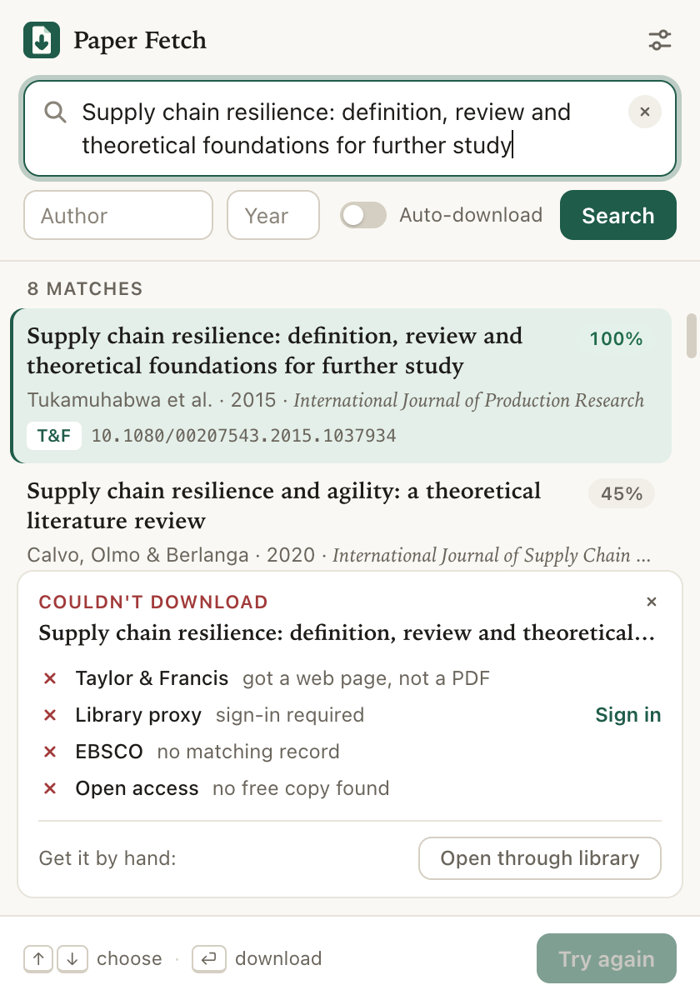

# Paper Fetch

[English](README.md)

一个 Chrome 扩展：粘贴论文标题或 DOI，自动把 PDF 下载下来。它只用你本来就有的访问权限——校园网、学校图书馆代理、EBSCO，或者论文的开放获取版本。

<p>
  
  
  
</p>

## 它做什么

1. 粘贴标题或 DOI，按 <kbd>Enter</kbd>。扩展到 [Crossref](https://www.crossref.org/) 查这篇论文，按匹配度列出结果。
2. 再按一次 <kbd>Enter</kbd>（或用 <kbd>↑</kbd> <kbd>↓</kbd> 换一条）。扩展按下面的顺序尝试，拿到 PDF 就停：

   | 途径 | 什么时候能用 |
   | --- | --- |
   | 出版社 | 你在校园网或学校 VPN 里，或者这篇文章在出版社网站免费 |
   | 图书馆代理 | 你已登录学校图书馆的 EZproxy |
   | EBSCO | 学校订了 EBSCO，并且你已登录 |
   | 开放获取 | [OpenAlex](https://openalex.org/) 收录了免费版本 |

3. PDF 存到"下载"文件夹，文件名是 `<第一作者姓><年份><标题首词>.pdf`，例如 `tukamuhabwa2015supply.pdf`。

如果四条途径都失败，弹窗会说明每一条卡在哪（需要登录、没有权限、EBSCO 里没有），并给一个按钮，通过图书馆打开文章页面，你可以手动下载。下载过程中关掉弹窗不影响下载。

## 安装

目前还没上架 Chrome 应用商店，需要从源码加载：

1. 下载本仓库（Code → Download ZIP 后解压），或者 `git clone`。
2. 打开 `chrome://extensions`，打开右上角的**开发者模式**，点**加载已解压的扩展程序**，选择 `extension` 文件夹。

第一次安装会自动打开设置页。

## 按你学校的情况设置

| 你的情况 | 怎么做 |
| --- | --- |
| 在校园网，或连着学校 VPN | 什么都不用设。 |
| 在校外，学校图书馆有 EZproxy | 把图书馆的代理链接粘贴到设置里（见下）。 |
| 学校订了 EBSCO | 在这个浏览器里登录一次 EBSCO，其余自动识别。 |
| 以上都没有 | 开放获取的论文仍然能下；其他论文会给你文章页面的链接。 |

**怎么找代理链接。** 它就是图书馆加在数据库链接前面的那一段，通常长这样：

```
https://login.ezproxy.youruni.edu/login?url=
https://youruni.idm.oclc.org/login?url=
```

可以搜"*学校名* EZproxy prefix"，或者在校外从图书馆网站点开任意一个数据库，把登录页的地址复制下来。整段地址直接粘贴进设置即可，`url=` 后面的部分会自动去掉。

## 支持范围

**出版社直连下载**只对"知道 DOI 就能推出 PDF 地址"的出版社有效：Wiley、Springer（含 Palgrave）、Taylor & Francis、Sage、INFORMS、Nature、Science、PNAS、ACS、ACM、SIAM、Academy of Management、芝加哥大学出版社、Royal Society、ASCE、IOP。其他出版社（Elsevier、IEEE、牛津、剑桥、JSTOR 等）靠 EBSCO 和开放获取；再不行就给你文章页面。

**测试到什么程度。** 自动化测试用替身服务器把每条途径都跑了一遍，另外实际请求了 Crossref、OpenAlex，并真实下载了两篇开放获取论文。真实使用只在一所大学的图书馆跑过。其他学校只要用 EZproxy 或 EBSCO，按理应该可用，但这是推断，还没有验证。欢迎反馈，成不成都有用。

**已知限制**

- EBSCO 这条途径是操作它的网页实现的，所以 EBSCO 界面语言必须是英文；对方改版也可能导致失效。
- 改写网址的 WebVPN 门户（内地高校常见）不能当作代理链接用。在校园网或全局 VPN 下，出版社直连本来就能用，不需要它。
- 设置里可以填 OpenAthens 的跳转链接，但没有测试过。
- 新增出版社的 PDF 地址按各平台的通用规则填写，只有 Nature 和 IOP 在真实网站上确认过。

## 隐私

Paper Fetch 没有自己的服务器，也没有任何统计。你搜索的标题或 DOI 会发给 Crossref；你下载的论文的 DOI 会发给 OpenAlex；下载请求发给出版社、图书馆代理或 EBSCO，和你自己点链接没有区别。设置只存在浏览器里。它用的是你已经登录的会话，接触不到密码。详见 [PRIVACY.md](PRIVACY.md)。

申请的权限：**downloads**（保存 PDF）、**storage**（保存设置）、**在 ebsco.com 上运行脚本**（在 EBSCO 页面上执行搜索）。

## 请在图书馆的使用条款之内使用

Paper Fetch 不绕过付费墙，只能拿到你的订阅或开放获取本来就给你的内容。出版社的许可协议禁止系统性批量下载，图书馆可能因此被停止访问，所以它只在你点的时候下载一篇。

## 开发

```
node tests/unit.mjs extension      # 标题匹配、文件命名、代理链接处理
node tests/e2e.mjs                 # 在无头 Chrome 里驱动真实扩展
node tests/e2e.mjs --shots docs/screenshots
scripts/package.sh                 # 生成 dist/paper-fetch-<版本>.zip
node scripts/icons.mjs              # 由 icons/icon.svg 重新生成各尺寸 PNG 图标
```

端到端测试需要 Chrome、`openssl` 和网络，用的是独立的临时浏览器配置，不会碰你自己的浏览器。

没有构建步骤，没有依赖。

## 许可证

[MIT](LICENSE)
